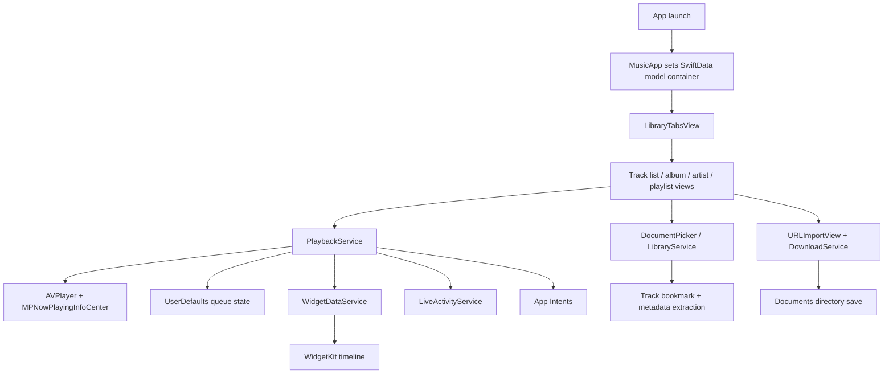

# Music iOS App

This repository currently contains a native SwiftUI music player app for iOS 17+ that was assembled as a separate Swift source tree. It is intentionally not an Expo/React Native app and does not contain an Xcode project file or generated native targets yet.

This document is meant to be a source-of-truth reference for AI coding agents and human developers working on this codebase.

## 1. Project overview

### 1.1 App name, purpose, platform, and iOS version
- App name: `Music`
- Purpose: local audio library playback, file import, URL import, queue management, remote controls, search, merge tools, and widget/Shortcuts integration
- Target platform: iOS
- Minimum iOS version: iOS 17.0 (explicitly set in the documentation and service usage; some APIs such as `ActivityKit` checks gate behavior with `@available(iOS 16.1, *)`)

### 1.2 Tech stack
- UI: SwiftUI
- Architecture: MVVM-like separation with SwiftUI views, view models, and protocol-based services
- Playback: `AVFoundation`, `AVPlayer`, `AVAudioSession`, `MPNowPlayingInfoCenter`, `MPRemoteCommandCenter`
- Persistence: SwiftData (`Track`, `Playlist`, `Album` models) plus `UserDefaults` for queue state, search history, and widget shared state
- Networking: `URLSession`, `NWPathMonitor` via `ConnectivityService`, remote feed parsing with JSON
- Widgets / app integrations: WidgetKit, App Intents, ActivityKit, App Groups
- Background download: `URLSessionConfiguration.background(withIdentifier:)`

### 1.3 Current status
This project is best described as an implementation scaffold / partial app, not a fully validated production app:

- Fully represented in source code:
  - main app shell and SwiftData models
  - local file import and bookmark persistence
  - basic AVPlayer queue and local playback controls
  - mini-player and full-screen Now Playing view
  - lock screen / Remote Command integration
  - direct URL import flow UI and service hooks
  - local-first search service and connectivty banner
  - duplicate merge, playlist merge, and audio export
  - liquid-glass-style song menus for playlist creation, favorites, queue actions, settings, and safe library removal
  - Now Playing actions for repeat-one and multi-track merging with a configurable crossfade up to 10 seconds
  - widget and App Intent stubs
  - settings and polish utilities
  - Liquid Glass surfaces on supported iOS versions with an iOS 17-compatible material fallback
  - hierarchical SF Symbols with animated tab and playback controls; no external icon assets are required
  - a custom saxophone-and-CD fallback artwork for tracks without embedded cover art

- Partially implemented or incomplete:
  - equalizer engine is not truly connected to active player audio processing
  - URL import does not implement full resume/retry/background completion handling in a production-ready way
  - the offline/search flow is present but the UI is not fully wired to the `SearchService`
  - widget/live activity integration requires real Xcode capabilities and extension targets not present in this repo
  - merge audio export uses `AVAssetExportSession` but does not fully implement practical crossfade details or user-visible progress beyond a basic `ProgressView`

- Not started or not present in repo:
  - `.xcodeproj` file
  - actual widget extension target
  - share extension target
  - app entitlements or Info.plist configuration files
  - real provisioning, App Group wiring, bundle IDs, or signing configuration
  - actual Xcode build validation

## 2. Project structure (file map)

### 2.1 File tree

```text
.
├── AGENTS.md
├── App/
│   └── MusicApp.swift
├── Intents/
│   └── MusicAppIntents.swift
├── LICENSE
├── Models/
│   └── LibraryModels.swift
├── README.md
├── Services/
│   ├── ConnectivityService.swift
│   ├── DownloadService.swift
│   ├── EqualizerService.swift
│   ├── LibraryService.swift
│   ├── LiveActivityService.swift
│   ├── LyricsService.swift
│   ├── MergeService.swift
│   ├── PlaybackService.swift
│   ├── RemoteMusicSource.swift
│   ├── SearchService.swift
│   ├── SleepTimerService.swift
│   ├── StorageManagerService.swift
│   └── WidgetDataService.swift
├── Tests/
│   └── MusicPhase5Tests.swift
├── Utilities/
│   └── Haptics.swift
├── ViewModels/
│   └── LibraryViewModel.swift
├── Views/
│   ├── DocumentPicker.swift
│   ├── LibraryViews.swift
│   ├── MergeViews.swift
│   ├── SettingsView.swift
│   └── URLImportView.swift
├── Widgets/
│   └── MusicWidgets.swift
└── .gitignore
```

### 2.2 File-by-file reference map

#### App

- **Path:** `App/MusicApp.swift`
  - **Purpose:** App entry point and SwiftData model container registration.
  - **Key types/functions:** `MusicApp: App`, `MusicApp.body`
  - **Depends on:** `Views/LibraryViews.swift`, `Models/LibraryModels.swift`
  - **Used by:** Xcode app target; no explicit callers in the repo itself

#### Models

- **Path:** `Models/LibraryModels.swift`
  - **Purpose:** Defines the SwiftData entities for library content and playback queue-related state.
  - **Key types/functions:** `Track`, `Playlist`, `Album`, `QueueRepeatMode`, `QueueState`
  - **Depends on:** Foundation, SwiftData
  - **Used by:** most app files under `Services`, `Views`, `ViewModels`, `Widgets`

- **Path:** `Models/LibraryModels.swift` (`Track` type)
  - **Purpose:** Single audio item in the library with metadata, file access, and playback-related state.
  - **Key types/functions:** `Track.id`, `Track.title`, `Track.artist`, `Track.albumTitle`, `Track.bookmarkData`, `Track.originalFilename`, `Track.bitrate`, `Track.isFavorite`, `Track.playCount`, `Track.sourceURL`, `Track.remoteURLString`
  - **Depends on:** `LibraryService` for bookmark creation/resolution
  - **Used by:** `PlaybackService`, `LibraryService`, `SearchService`, `LibraryViews`, `MergeService`, `URLImportView`

- **Path:** `Models/LibraryModels.swift` (`Playlist` type)
  - **Purpose:** Stores a name and JSON-encoded array of track IDs.
  - **Key types/functions:** `Playlist.trackIDsData`, `Playlist.trackIDs` computed property
  - **Depends on:** Foundation, SwiftData
  - **Used by:** `Views/LibraryViews.swift`, `Services/MergeService.swift`

- **Path:** `Models/LibraryModels.swift` (`Album` type)
  - **Purpose:** Groups tracks by album title and artist.
  - **Key types/functions:** `Album.trackIDsData`, `Album.trackIDs`
  - **Depends on:** Foundation, SwiftData
  - **Used by:** `Services/LibraryService.swift`, `Views/LibraryViews.swift`

- **Path:** `Models/LibraryModels.swift` (`QueueRepeatMode` enum)
  - **Purpose:** Queue repeat options for playback.
  - **Key types/functions:** `.off`, `.all`, `.one`, `title`
  - **Depends on:** Swift standard library
  - **Used by:** `PlaybackService`, `LibraryViews`, `MergeService`

- **Path:** `Models/LibraryModels.swift` (`QueueState` struct)
  - **Purpose:** Persisted queue state snapshot (track IDs, current track, playback position, shuffle/repeat state).
  - **Key types/functions:** `QueueState.trackIDs`, `QueueState.currentTrackID`, `QueueState.position`, `QueueState.isShuffled`, `QueueState.repeatMode`
  - **Depends on:** `QueueRepeatMode`
  - **Used by:** `PlaybackService` for save/restore

#### Services

- **Path:** `Services/LibraryService.swift`
  - **Purpose:** Imports local audio files from Files/Folders, creates bookmark data for security-scoped access, extracts metadata, updates album indexes, and resolves track URLs.
  - **Key types/functions:** `LibraryError`, `LibraryServicing`, `LibraryService.importItems`, `resolveURL`, `collectAudioFiles`, `updateAlbum`, `importFile`
  - **Depends on:** `Models/LibraryModels.swift`, `AVFoundation`, `SwiftData`, `UniformTypeIdentifiers`
  - **Used by:** `ViewModels/LibraryViewModel.swift`, `Views/URLImportView.swift` (indirectly), `PlaybackService` for file resolution

- **Path:** `Services/PlaybackService.swift`
  - **Purpose:** Central playback engine for queue, playback controls, resume state, remote commands, and lock screen metadata.
  - **Key types/functions:** `PlaybackServicing`, `PlaybackService.shared`, `play`, `resume`, `togglePlayback`, `next`, `previous`, `seek`, `skip`, `setRepeatMode`, `toggleShuffle`, `setPlaybackRate`, `addToQueue`, `playNext`, `moveQueue`, `installRemoteCommands`, `updateNowPlaying`
  - **Depends on:** `LibraryService`, `Models/LibraryModels.swift`, `WidgetDataService`, `LiveActivityService`
  - **Used by:** `Views/LibraryViews.swift`, `Intents/MusicAppIntents.swift`, `SleepTimerService.swift`, `Widgets/MusicWidgets.swift` indirectly

- **Path:** `Services/ConnectivityService.swift`
  - **Purpose:** Wraps `NWPathMonitor` and exposes online/offline state and banner visibility.
  - **Key types/functions:** `ConnectivityService`, `isOnline`, `isOfflineBannerVisible`
  - **Depends on:** Network framework
  - **Used by:** `SearchService`, `Views/LibraryViews.swift` (through a local state instance)

- **Path:** `Services/DownloadService.swift`
  - **Purpose:** Downloads audio files from URLSession, saves them to the Documents directory, and exposes a resume API.
  - **Key types/functions:** `DownloadServicing`, `DownloadService.shared`, `download`, `resumeDownload`, `storeDownloadedFile`
  - **Depends on:** Foundation
  - **Used by:** `Views/URLImportView.swift`

- **Path:** `Services/EqualizerService.swift`
  - **Purpose:** Defines equalizer presets and a placeholder engine-level EQ service.
  - **Key types/functions:** `EqualizerPreset`, `EqualizerServicing`, `EqualizerService.setPreset`, `setPlaybackRate`, `applyEngineEQ`
  - **Depends on:** `AVFoundation`
  - **Used by:** `Views/SettingsView.swift` (UI only), not actively wired to `PlaybackService`

- **Path:** `Services/LiveActivityService.swift`
  - **Purpose:** Starts and stops a Dynamic Island / Live Activity using `ActivityKit`.
  - **Key types/functions:** `LiveActivityService`, `NowPlayingAttributes`, `DynamicIslandState`
  - **Depends on:** `ActivityKit`, `Track`
  - **Used by:** `PlaybackService.updateNowPlaying`

- **Path:** `Services/LyricsService.swift`
  - **Purpose:** Loads `.lrc` sidecar lyrics near the track and parses timestamped lines.
  - **Key types/functions:** `LyricLine`, `LyricsServicing`, `LyricsService.loadLyrics`, `parseLRC`
  - **Depends on:** `LibraryService`, `Track`
  - **Used by:** no active view or service in the current repo; defined for future UI integration

- **Path:** `Services/MergeService.swift`
  - **Purpose:** Provides duplicate detection, playlist merge, and audio merge export for selected tracks.
  - **Key types/functions:** `MergeServicing`, `MergeService.detectDuplicateTracks`, `mergeDuplicateTracks`, `mergePlaylists`, `exportMergedAudio`
  - **Depends on:** `AVFoundation`, `SwiftData`, `LibraryService` file resolution helpers
  - **Used by:** `Views/MergeViews.swift`, `Views/LibraryViews.swift`

- **Path:** `Services/RemoteMusicSource.swift`
  - **Purpose:** Defines the protocol and a JSON-based remote feed implementation for remote search results.
  - **Key types/functions:** `RemoteSearchResult`, `RemoteMusicSource`, `FeedItem`, `JSONFeedRemoteMusicSource.search`
  - **Depends on:** Foundation, `URLSession`
  - **Used by:** `SearchService`, future search UIs

- **Path:** `Services/SearchService.swift`
  - **Purpose:** Performs local-first search; if online, appends remote feed results.
  - **Key types/functions:** `SearchService.performSearch`, `recentSearches`, `localResults`, `onlineResults`, `offlineBannerVisible`
  - **Depends on:** `ConnectivityService`, `RemoteMusicSource`, `Track`
  - **Used by:** no main view is currently calling it; currently a standalone service

- **Path:** `Services/SleepTimerService.swift`
  - **Purpose:** Starts and stops a timer that pauses playback after a duration.
  - **Key types/functions:** `SleepTimerService.start`, `stop`, `remainingSeconds`
  - **Depends on:** `PlaybackService`
  - **Used by:** `Views/SettingsView.swift`

- **Path:** `Services/StorageManagerService.swift`
  - **Purpose:** Reports Document and cache sizes and clears cache content.
  - **Key types/functions:** `StorageManaging`, `StorageManagerService.documentsUsage`, `cachedUsage`, `clearCache`
  - **Depends on:** Foundation, FileManager
  - **Used by:** `Views/SettingsView.swift`

- **Path:** `Services/WidgetDataService.swift`
  - **Purpose:** Stores now-playing state in an App Group user defaults container and notifies WidgetKit to refresh.
  - **Key types/functions:** `WidgetTrackState`, `WidgetDataServicing`, `WidgetDataService.saveNowPlayingState`, `loadNowPlayingState`
  - **Depends on:** Foundation, `WidgetKit`
  - **Used by:** `PlaybackService.updateNowPlaying`, `Widgets/MusicWidgets.swift`

#### ViewModels

- **Path:** `ViewModels/LibraryViewModel.swift`
  - **Purpose:** Coordinates local file import actions and exposes import state/error messaging.
  - **Key types/functions:** `LibraryViewModel.importItems`, `isImporting`, `errorMessage`
  - **Depends on:** `LibraryServicing`
  - **Used by:** `Views/LibraryViews.swift`

#### Views

- **Path:** `Views/DocumentPicker.swift`
  - **Purpose:** SwiftUI wrapper around `UIDocumentPickerViewController` to choose audio files or folders.
  - **Key types/functions:** `DocumentPicker`, `Coordinator`, `documentPicker(_:didPickDocumentsAt:)`
  - **Depends on:** `SwiftUI`, `UIKit`, `UniformTypeIdentifiers`
  - **Used by:** `Views/LibraryViews.swift`

- **Path:** `Views/LibraryViews.swift`
  - **Purpose:** Main app UI: library tabs, track list, album/artist/playlist grouping, mini player, full-screen Now Playing, queue editor, and edit-tag sheet.
  - **Key types/functions:** `LibraryTabsView`, `TrackList`, `AlbumList`, `ArtistList`, `PlaylistList`, `MiniPlayer`, `NowPlayingView`, `QueueView`, `EditTrackView`, `ArtworkView`, `formatTime`
  - **Depends on:** most of the services and models; `PlaybackService`, `LibraryViewModel`, `DocumentPicker`, `MergeService`, `SettingsView`, `URLImportView`
  - **Used by:** `App/MusicApp.swift`

- **Path:** `Views/MergeViews.swift`
  - **Purpose:** Merge-related UI for duplicates, playlist merge, and audio merge export.
  - **Key types/functions:** `MergeDuplicatesView`, `PlaylistMergeView`, `AudioMergeView`
  - **Depends on:** `MergeService`, `Track`, `Playlist`
  - **Used by:** `Views/LibraryViews.swift`

- **Path:** `Views/SettingsView.swift`
  - **Purpose:** Settings screen for feed URLs, playback rate, EQ preset, sleep timer, offline behavior, storage, and accessibility toggles.
  - **Key types/functions:** `SettingsView`
  - **Depends on:** `EqualizerService`, `StorageManagerService`, `SleepTimerService`
  - **Used by:** `Views/LibraryViews.swift`

- **Path:** `Views/URLImportView.swift`
  - **Purpose:** Screen to validate and download direct audio URLs from the network.
  - **Key types/functions:** `URLImportViewModel`, `validateURL`, `beginImport`, `URLImportView`
  - **Depends on:** `DownloadService`, `LibraryService`, `AVFoundation`, `SwiftData`
  - **Used by:** `Views/LibraryViews.swift`

#### Widgets

- **Path:** `Widgets/MusicWidgets.swift`
  - **Purpose:** Widget bundle and timeline provider for the now-playing widget.
  - **Key types/functions:** `NowPlayingWidgetEntry`, `NowPlayingWidgetView`, `NowPlayingWidget`, `Provider`, `MusicWidgets`
  - **Depends on:** `WidgetDataService`, `WidgetKit`, `SwiftUI`
  - **Used by:** iOS widget system; no explicit in-app callers

#### Intents

- **Path:** `Intents/MusicAppIntents.swift`
  - **Purpose:** Defines App Intents that expose playback actions to Siri, widgets, and Shortcuts.
  - **Key types/functions:** `PlayPauseIntent`, `NextTrackIntent`, `ShuffleLibraryIntent`
  - **Depends on:** `AppIntents`, `PlaybackService`
  - **Used by:** Siri / Shortcuts / widget integration; no direct in-app code references

#### Utilities

- **Path:** `Utilities/Haptics.swift`
  - **Purpose:** Simple haptic feedback helper for UI actions.
  - **Key types/functions:** `Haptics.impact`, `Haptics.notify`
  - **Depends on:** UIKit
  - **Used by:** no current explicit callers in the repo

#### Tests

- **Path:** `Tests/MusicPhase5Tests.swift`
  - **Purpose:** Basic XCTest coverage for queue logic, duplicate detection, URL validation, and connectivity defaults.
  - **Key types/functions:** `MusicPhase5Tests.testQueueLogicKeepsCurrentItemFirst`, `testDuplicateDetectionMatchesTitleArtistAndDurationTolerance`, `testDirectURLValidationRejectsMissingHost`, `testConnectivityDefaultsToOnline`
  - **Depends on:** `XCTest`, `Track`, `MergeService`, `URLImportViewModel`, `ConnectivityService`
  - **Used by:** Xcode test target; no in-app code references

## 3. Data models

### 3.1 `Track`
Defined in `Models/LibraryModels.swift`.

```swift
@Model
final class Track {
    @Attribute(.unique) var id: UUID
    var title: String
    var artist: String
    var albumTitle: String
    var duration: Double
    var artworkData: Data?
    var bookmarkData: Data
    var originalFilename: String
    var bitrate: Double?
    var isFavorite: Bool
    var playCount: Int
    var dateAdded: Date
    var sourceURL: String?
    var isDownloaded: Bool
    var isAvailableOffline: Bool
    var remoteURLString: String?
}
```

- Relationships:
  - Track objects can be read and displayed via album grouping and playlist `UUID` arrays.
  - A `Playlist` stores track IDs; an `Album` stores track IDs.
- Persistence:
  - SwiftData model persisted in the app model container (`App/MusicApp.swift`)
  - `bookmarkData` is a security-scoped bookmark used to reopen the original file after relaunch
  - `remoteURLString` is stored in the model but not yet used by a downloader object in the code path

### 3.2 `Playlist`
Defined in `Models/LibraryModels.swift`.

```swift
@Model
final class Playlist {
    @Attribute(.unique) var id: UUID
    var name: String
    var createdAt: Date
    var trackIDsData: Data
    var trackIDs: [UUID] { get set }
}
```

- Persistence:
  - SwiftData (`@Model`)
  - internal array stored as JSON in `trackIDsData`

### 3.3 `Album`
Defined in `Models/LibraryModels.swift`.

```swift
@Model
final class Album {
    @Attribute(.unique) var id: UUID
    var title: String
    var artist: String
    var artworkData: Data?
    var trackIDsData: Data
    var trackIDs: [UUID] { get set }
}
```

- Persistence:
  - SwiftData
  - `trackIDsData` contains a JSON-encoded `[UUID]`

### 3.4 `QueueRepeatMode`
Defined in `Models/LibraryModels.swift`.

- Values: `.off`, `.all`, `.one`
- Persistence:
  - saved into `QueueState` and serialized to `UserDefaults` as JSON

### 3.5 `QueueState`
Defined in `Models/LibraryModels.swift`.

```swift
struct QueueState: Codable {
    var trackIDs: [UUID] = []
    var currentTrackID: UUID?
    var position: Double = 0
    var isShuffled = false
    var repeatMode: QueueRepeatMode = .off
}
```

- Persistence:
  - `UserDefaults.standard` key `music.queueState`
  - used by `PlaybackService.persistState()` and `resume(from:)`

### 3.6 Additional persisted values in app settings
- `UserDefaults.standard` key `music.recentSearches` in `SearchService`
- `UserDefaults.standard` key `music.feedURLs` in `SettingsView`
- App Group key `music.nowPlaying.widget` in `WidgetDataService`

## 4. App workflows

### 4.1 App launch and state restoration
Main flow:
`App/MusicApp.swift` -> `LibraryTabsView` -> `PlaybackService.resume(from:)` -> `UserDefaults` `music.queueState`

Files involved:
- `App/MusicApp.swift` — app entry point
- `Views/LibraryViews.swift` — `LibraryTabsView.body`, `restorePlaybackIfReady()`
- `Services/PlaybackService.swift` — `resume(from:)`, `persistState()`, `start(_:, at:)`
- `Models/LibraryModels.swift` — `QueueState`, `Track`, `Playlist`, `Album`

Breakdown:
1. `MusicApp` creates the SwiftData container with `[Track.self, Playlist.self, Album.self]`.
2. `LibraryTabsView` shows the main tab view and executes `.task { restorePlaybackIfReady() }`.
3. `restorePlaybackIfReady()` checks if playback has not yet been restored and whether the library has any tracks.
4. `playback.resume(from: tracks)` decodes the `QueueState` from `UserDefaults` using JSON.
5. If `currentTrackID` exists, it rebuilds the queue from the track list and calls `start(track, at: saved.position)`.

### 4.2 Playback flow
Files involved:
- `Services/PlaybackService.swift`
- `Views/LibraryViews.swift`
- `Intents/MusicAppIntents.swift`
- `Models/LibraryModels.swift`

Main actions:
- `PlaybackService.play(_:, from:)` sets the queue, current track, and calls `start(_:, at:)`
- `PlaybackService.togglePlayback()` toggles AVPlayer state and updates UI
- `PlaybackService.next()` and `previous()` navigate the queue and support repeat mode logic
- `seek(to:)`, `skip(by:)` update `elapsed` and `state.position`
- `toggleShuffle()` reorders the queue when enabled
- `setRepeatMode(_:)` updates the repeat state
- `moveQueue(from:to:)` reorders the list in `QueueView`

Lock screen / remote controls are handled by:
- `PlaybackService.installRemoteCommands()`
- `MPNowPlayingInfoCenter.default().nowPlayingInfo = info`
- `AVAudioSession` interruption / route notifications inside `observeAudioSession()`

### 4.3 Import from Files
Files involved:
- `Views/DocumentPicker.swift`
- `Views/LibraryViews.swift`
- `ViewModels/LibraryViewModel.swift`
- `Services/LibraryService.swift`
- `Models/LibraryModels.swift`

Breakdown:
1. `LibraryTabsView` presents `DocumentPicker` via a sheet.
2. `DocumentPicker` uses `UIDocumentPickerViewController(forOpeningContentTypes: [.audio, .folder])` with `allowsMultipleSelection = true`.
3. `didPickDocumentsAt` calls back to `LibraryTabsView.onPick` which invokes `viewModel.importItems(urls, into: modelContext)`.
4. `LibraryViewModel.importItems` calls `libraryService.importItems(urls, into: context)`.
5. `LibraryService.importItems` uses `collectAudioFiles(from:)` and filters by `supportedExtensions`.
6. For each file, `LibraryService.importFile` reads metadata with `AVURLAsset` and creates a `Track` with `bookmarkData` created via `makeBookmark(for:)` and `Track.originalFilename`.
7. Album metadata is updated via `updateAlbum(for:track:)`.
8. `resolveURL(for:)` reopens the bookmark and verifies the file still exists.

Important note: this is the only supported local filesystem import flow in the code, matching the requirement to avoid manual path entry.

### 4.4 Import from URL
Files involved:
- `Views/URLImportView.swift`
- `Services/DownloadService.swift`
- `Models/LibraryModels.swift`

Breakdown:
1. `URLImportView` shows a text field and “Download” button.
2. `URLImportViewModel.validateURL()` checks that the URL has a scheme and host.
3. `beginImport()` performs a HEAD-like `URLSession.shared.data(for:)` request to inspect `Content-Type` headers.
4. If the type is accepted, `DownloadService.download(from:)` downloads the file with a background `URLSessionConfiguration.background(withIdentifier: "MusicDownloads")`.
5. The downloaded file is moved into the Documents directory by `storeDownloadedFile(from:sourceURL:)`.
6. A `Track` is inserted into SwiftData with `isDownloaded = true` and a saved `bookmarkData`.

This flow is present but not fully production-ready. It does not implement retry/resume UI or a robust background completion callback architecture.

### 4.5 Search flow and offline fallback
Files involved:
- `Services/SearchService.swift`
- `Services/ConnectivityService.swift`
- `Services/RemoteMusicSource.swift`
- `Views/LibraryViews.swift`
- `Views/SettingsView.swift`

Behavior as implemented:
1. `SearchService.performSearch(_:)` trims the query, records recent searches, and clears results when empty.
2. It computes `localResults` by checking title, artist, album title, and filename against the query.
3. If `connectivity.isOnline` is true, it calls `remoteSource.search(trimmed)`.
4. `JSONFeedRemoteMusicSource.search(_:)` loops over feed URLs and decodes JSON feed items, then filters them by title/artist/album text.
5. `offlineBannerVisible = !connectivity.isOnline` is set to show a library-only banner.
6. If offline, online search is skipped and only local results are returned.

Important limitation: `LibraryTabsView` contains a local `searchText` field in `TrackList`, but it does not invoke `SearchService`. The `SearchService` type exists as a standalone component and is not wired into the main UI yet.

### 4.6 Auto merge
Files involved:
- `Services/MergeService.swift`
- `Views/MergeViews.swift`
- `Views/LibraryViews.swift`

Implemented behaviors:
- `detectDuplicateTracks(in:)` compares normalized title, artist, and duration difference within 2.0 seconds.
- `mergeDuplicateTracks(_:in:)` keeps the higher-bitrate track and merges metadata/favorites/play counts.
- Duplicate merging removes the lower-ranked copy from the library but leaves its original file untouched.
- `mergePlaylists(_:into:name:in:)` deduplicates track IDs while preserving order.
- `exportMergedAudio(from:crossfade:outputName:)` mixes selected tracks with volume-ramped crossfades (up to 10 seconds) and exports to `.m4a`.
- Song deletion removes the library entry and playlist references only; the original audio file remains in Files.
- Playlist creation uses a compact glass sheet with a top-right Cancel action and a checkmark beside the name field.

Current status: the audio merge flow supports track selection, crossfade configuration, export, and importing the result into the library. It still requires an Xcode target to compile and run on iOS.

### 4.7 Widget and Live Activity data flow
Files involved:
- `Services/WidgetDataService.swift`
- `Widgets/MusicWidgets.swift`
- `Services/LiveActivityService.swift`
- `Services/PlaybackService.swift`
- `Intents/MusicAppIntents.swift`

Flow:
1. `PlaybackService.updateNowPlaying()` prepares a `WidgetTrackState` containing title, artist, artwork, playing status, and queue count.
2. `WidgetDataService.shared.saveNowPlayingState(_:)` writes the state to App Group `UserDefaults` using `group.com.yourcompany.Music`.
3. `WidgetCenter.shared.reloadAllTimelines()` refreshes widgets.
4. `MusicWidgets.swift` reads the timeline state in `Provider.getSnapshot` and `getTimeline`.
5. `LiveActivityService.startActivity(track:)` requests a `NowPlayingAttributes` activity if ActivityKit is enabled.
6. App Intents call into `PlaybackService.shared.togglePlayback()`, `.next()`, and `.toggleShuffle()` through `PlayPauseIntent`, `NextTrackIntent`, and `ShuffleLibraryIntent`.

Important limitation: no actual App Group or widget extension target exists in the repo; this code is a scaffold for Xcode integration.

### 4.8 Lock Screen / Control Center / remote command handling
Files involved:
- `Services/PlaybackService.swift`

Handling implemented:
- `installRemoteCommands()` attaches targets for play, pause, next, previous, skip backwards/forwards, and change playback position.
- `MPNowPlayingInfoCenter.default().nowPlayingInfo` is updated with title, artist, album, elapsed time, and optional artwork.
- `AVAudioSession.interruptionNotification` and `routeChangeNotification` pause playback when interruptions or route changes occur.

### 4.9 Main flow diagram



## 5. Setup and configuration

### 5.1 Xcode and project state
This repo does not currently contain an `.xcodeproj` file or any native target metadata. Everything is a source folder, not a complete Xcode app project.

Minimum configuration to create in Xcode:
- Xcode 15 or newer
- iOS app target
- deployment target: iOS 17.0
- language: Swift
- interface: SwiftUI
- default app name: `Music`

### 5.2 Required capabilities and entitlements
From the code and docs 
- Background Modes: Audio, AirPlay, and Picture in Picture
- App Groups: `group.com.yourcompany.Music`
- Widget Extension target: required for `Widgets/MusicWidgets.swift`
- App Intents support: required for `Intents/MusicAppIntents.swift`
- ActivityKit: required for `Services/LiveActivityService.swift`

### 5.3 Targets to create in Xcode
- App target: `Music`
- Widget Extension target: e.g. `MusicWidgetsExtension`
- Optional Share Extension target: not present in code; would be required for true “Open In…” and share-sheet import flow

### 5.4 Bundle IDs / App Group IDs
The current code references this App Group ID:
- `group.com.yourcompany.Music`

There are no real bundle identifiers, provisioning profiles, or app IDs defined in this repo. These must be created in Xcode when the project is set up on a Mac.

### 5.5 Required Info.plist keys and entitlements
Not present in the repo as generated plist files. In a real Xcode project, expected entries include at least:
- `UIBackgroundModes` with `audio`, `airplay`, `picture-in-picture`
- `NSAppleMusicUsageDescription` if you intend to access media library metadata in a broader app context (not currently used directly)
- App Group entitlements referencing `group.com.yourcompany.Music`
- `NSExtension` entries for any future widget/share extensions

### 5.6 Build and run steps
1. Open the project on a Mac in Xcode.
2. Create or import the native app target named `Music`.
3. Add the directories `App`, `Models`, `Services`, `ViewModels`, `Views`, `Widgets`, `Intents`, `Utilities`, and `Tests` to the target.
4. Set the app entry point to `App/MusicApp.swift`.
5. Add the required capabilities and app group entitlement.
6. Build and run on a simulator or physical device.

### 5.7 Simulator vs real device
- Simulator:
  - file import works through the Files app picker only if the simulator is configured appropriately; some audio import behaviors are easier to test on a physical device
  - widgets and live activity are limited in a simulator
- Real device:
  - required for background audio, MPRemoteCommand, AirPlay behavior, and lock screen controls
  - required for App Group and widget validation
  - strongly recommended for testing document pickers, real background sessions, and playback interruptions

## 6. Conventions for AI agents

### 6.1 Coding style and naming conventions
- Swift naming and style follow Apple conventions: `PascalCase` for types, `camelCase` for methods and properties.
- Views are `struct` types conforming to `View`.
- Services are `final class` types behind protocol interfaces when possible.
- Models are `@Model` classes for SwiftData persistence.
- `@MainActor` is used for UI-related service logic and `ObservableObject`/`@Observable` state.
- `async`/`await` is used for asynchronous file import, networking, metadata extraction, and URL import logic.

### 6.2 Rules used in this codebase
- Keep services behind protocols to ease mocking and testing.
- Prefer explicit error handling via `LocalizedError` or localized user messages.
- Avoid force-unwraps and silent failures where possible.
- Use SwiftData for persisted library entities and `UserDefaults` for lightweight app settings.
- Keep UI and business logic separated; the current design is a lightweight MVVM / service layer.
- Prefer `URL`-based file access with `bookmarkData` for local file persistence.

### 6.3 Where to add new features
- App entry points and root configuration: `App/`
- Library entities and queue state: `Models/`
- Playlists, persistence, metadata, import, search, merge, widget state, connection state: `Services/`
- UI flows and screens: `Views/`
- App state and import actions: `ViewModels/`
- Widget and Siri/Shortcut integrations: `Widgets/` and `Intents/`
- Shared helper logic: `Utilities/`
- Tests: `Tests/`

### 6.4 Before you change anything checklist
1. Read this README and the relevant file(s) before editing.
2. Identify the service or view that owns the behavior you are changing.
3. Check whether the feature is already partially implemented and update the right service/protocol.
4. Add or update targeted tests in `Tests/` when changing queue, duplicate detection, URL validation, or connectivity logic.
5. Keep the project structure consistent with the folder boundaries above.
6. Do not silently add dependency/frameworks without documenting the reason.

### 6.5 Do not do
- Do not add YouTube, Spotify, or other scraping-based streaming flows.
- Do not add a manual filesystem path text field; local file picking is intentionally done through `UIDocumentPickerViewController`.
- Do not add third-party libraries without a clear justification and a note in the README/change log.
- Do not call `force unwrap` on optional values from file/data/network layers.
- Do not ignore stale bookmark errors or invalid URL failures.
- Do not assume the app is buildable without Xcode; validation must happen on macOS.

## 7. Known issues and TODO

### 7.1 High-priority issues
1. There is no actual Xcode project file or native target configuration in the repo. The app cannot be built as-is.
2. `Services/EqualizerService.swift` is a scaffold; it does not actively apply EQ to the current `AVPlayer` or `AVAudioEngine` pipeline.
3. `SearchService` exists but is not integrated into the main `LibraryTabsView` search UI.
4. `DownloadService` is not a complete production implementation: the background delegate flow and resume/retry logic are partial and not wired to a user-visible retry screen.
5. App Group / Widget / App Intents integration requires actual Xcode extension targets and provisioning; there are no real targets here.

### 7.2 Medium-priority issues
1. `PlaybackService.updateNowPlaying()` calls `LiveActivityService.shared.startActivity(track:)` for every update; this may create repeated or redundant activity requests rather than updating an existing state cleanly.
2. `Wake`/`stale bookmark` recovery is only partially handled in `LibraryService.resolveURL(for:)`.
3. `URLImportViewModel.beginImport()` validates URL content types but does not fully handle resume logic, progress state, or all audio MIME edge cases.
4. `SettingsView` calls `SleepTimerService().start(...)` and `.stop()` without retaining a shared service instance; timing is currently local to the view instance.

### 7.3 Low-priority / maintenance issues
1. `LibraryViewModel` is functional but only covers import state; no further UI actions are centralized there.
2. `Haptics.swift` is used by track-menu, playlist, favorite, and selection interactions but is not yet centralized across every UI action.
3. `LyricsService` is defined but not bound to any view or playback controller.
4. `EqualizerService` includes a placeholder `AVAudioEngine` setup that is not used in the main player pipeline.
5. Some tests are smoke tests, not behaviorally deep validation.

### 7.4 Prioritized next steps
1. Create an Xcode project and real app target, add required capabilities and App Group.
2. Wire `SearchService` into the main library UI and make offline/local-first search observable.
3. Replace scaffolded playback polish with real engine hooks for EQ, crossfade, and rate controls.
4. Finish the URL import and resume/retry flow with real background completion status and user feedback.
5. Create the widget extension target and validate App Group sharing.
6. Complete the Live Activity and App Intent flow with Xcode native target validation.
7. Add more realistic unit tests and compile fixes after Xcode build validation.

## 8. Change log

```text
YYYY-MM-DD, what changed, files touched
2026-11-17, Initial project documentation and repository audit, README.md, App/MusicApp.swift, Models/LibraryModels.swift, Services/*.swift, Views/*.swift, Widgets/MusicWidgets.swift, Intents/MusicAppIntents.swift, Tests/MusicPhase5Tests.swift
```

## Files I could not understand or that look unused

- `Utilities/Haptics.swift` - present and valid, but no in-app call sites were found in the current codebase.
- `Services/LyricsService.swift` - implemented, but no view or service currently calls it.
- `Services/SearchService.swift` - implemented, but not currently bound to the primary `LibraryTabsView` UI search flow.
- `Services/EqualizerService.swift` - functional scaffold, but not wired into the active playback engine.
- `Services/DownloadService.swift` - partially implemented but not fully connected to a complete retry/resume workflow.
- `Widgets/MusicWidgets.swift` - scaffold for widget integration; no actual widget extension target exists in the repo.

This repository is an intentionally structured but not yet Xcode-validated native app scaffold. It is suitable for continued development on a Mac with Xcode, but it should not be treated as a completed production build.
